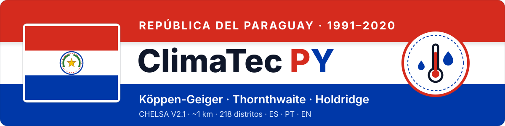

<div align="center">

<a href="https://fcoliveira-utfpr.github.io/climate_paraguay/"></a>

# 🇵🇾 ClimaTec PY

### El clima del Paraguay, píxel a píxel y distrito por distrito

<a href="https://fcoliveira-utfpr.github.io/climate_paraguay/"></a>
<a href="https://fcoliveira-utfpr.github.io/climate_paraguay/?secao=atlas"></a>
<a href="https://fcoliveira-utfpr.github.io/climate_paraguay/mapa.html?sistema=koppen"></a>


[](https://github.com/fcoliveira-utfpr/agrometeorologiapy)
[](https://chelsa-climate.org/)
[](#-metodología)
[](#-idiomas)

| 🌧️ **Köppen-Geiger** | 💧 **Thornthwaite** | 🌳 **Holdridge** |
|:---:|:---:|:---:|
| 6 clases | 5 clases de humedad | 2 zonas de vida |
| [Abrir mapa →](https://fcoliveira-utfpr.github.io/climate_paraguay/mapa.html?sistema=koppen) | [Abrir mapa →](https://fcoliveira-utfpr.github.io/climate_paraguay/mapa.html?sistema=thornthwaite) | [Abrir mapa →](https://fcoliveira-utfpr.github.io/climate_paraguay/mapa.html?sistema=holdridge) |

</div>

Clasificaciones climáticas de **Köppen-Geiger**, **Thornthwaite** y **zonas de vida de Holdridge** para todo el
Paraguay, calculadas en cada píxel de ~1 km a partir de las normales climatológicas **1991–2020** de
**CHELSA V2.1**, con la biblioteca [`agrometeorologiapy`](https://github.com/fcoliveira-utfpr/agrometeorologiapy),
y resumidas por **distrito** (218) y **departamento** (17 + Asunción). Es la versión paraguaya de
[ClimaTec Data — climas_brasil](https://fcoliveira-utfpr.github.io/climas_brasil/).

<p align="center"></p>

## 📑 Contenido

- [Qué ofrece el sitio](#️-qué-ofrece-el-sitio)
- [Resultados principales](#-resultados-principales)
- [Estructura de los archivos](#-estructura-de-los-archivos)
- [Formato de los datos](#-formato-de-los-datos)
- [Metodología](#-metodología)
- [Idiomas](#-idiomas)
- [Uso local](#-uso-local)
- [Bibliotecas utilizadas](#-bibliotecas-utilizadas)
- [Fuentes de datos y referencias](#-fuentes-de-datos-y-referencias)
- [Autoría](#-autoría)

<p align="center"></p>

## 🗺️ Qué ofrece el sitio

| Página | Contenido |
|---|---|
| [Inicio](https://fcoliveira-utfpr.github.io/climate_paraguay/) | Presentación, pestañas **Mapas** y **Atlas** |
| [Köppen-Geiger](https://fcoliveira-utfpr.github.io/climate_paraguay/mapa.html?sistema=koppen) | Mapa interactivo de la clasificación de Köppen-Geiger |
| [Thornthwaite](https://fcoliveira-utfpr.github.io/climate_paraguay/mapa.html?sistema=thornthwaite) | Humedad, variación estacional, eficiencia térmica y concentración estival |
| [Holdridge](https://fcoliveira-utfpr.github.io/climate_paraguay/mapa.html?sistema=holdridge) | Zonas de vida de Holdridge |

En cada mapa:

- clasificación **píxel a píxel** (~1 km) con los límites de distritos y departamentos encima;
- filtros por **departamento** y **distrito**, y control de **opacidad**;
- al hacer clic en un distrito: **clase mayoritaria** (% del área), **índices climáticos**, **climograma mensual**
  (precipitación, ETP y temperatura media) y descarga en **CSV**;
- **todos los climas del distrito** con el % del área de cada uno (barra y lista; también al pasar el mouse),
  porque muchos distritos tienen más de un clima;
- **clima en el punto clicado**, leído en la capa de ~1 km (en Thornthwaite, el tipo climático completo del punto);
- enlace directo a un distrito y a un punto: `mapa.html?sistema=koppen&distrito=PRY.5.3_1&ponto=-22.3,-60.9`
  (código GADM del distrito; latitud, longitud).

El **Atlas** reúne 16 mapas nacionales (clasificaciones y variables climatológicas), en los tres idiomas.

<p align="center"></p>

## 📊 Resultados principales

Porcentaje del área del país:

| Clasificación | Resultado |
|---|---|
| 🌧️ **Köppen-Geiger** | Aw 42,7% · Cfa 33,3% · BSh 12,2% · Am 8,3% · Cwa 2,2% · Af 1,3% |
| 💧 **Thornthwaite** (humedad, CAD = 100 mm) | D 40,9% · C1 33,1% · C2 20,0% · B1 5,7% · B2 0,4% |
| 🌳 **Holdridge** (ETP de Holdridge) | Bosque húmedo subtropical 54,4% · Bosque seco subtropical 45,6% |

El patrón sigue el gradiente oeste–este de la lluvia (≈ 700 mm/año en el Chaco central y ≈ 1.800 mm/año en el
este): clima semiárido (BSh, D) y bosque seco en el Chaco occidental; límite Aw/Cfa cerca de 24,5°S, donde el
mes más frío baja de 18 °C; clima húmedo (Cfa, C2, B1) en la Región Oriental.

| Ciudad | Köppen | Thornthwaite | Holdridge |
|---|---|---|---|
| Mariscal Estigarribia | BSh | DdA′a′ | Bosque seco subtropical |
| Filadelfia | Aw | DdA′a′ | Bosque seco subtropical |
| Concepción | Aw | C1dA′a′ | Bosque húmedo subtropical |
| Asunción | Cfa | C1dA′a′ | Bosque húmedo subtropical |
| Pedro Juan Caballero | Cfa | C2rA′a′ | Bosque húmedo subtropical |
| Encarnación | Cfa | B1rA′a′ | Bosque húmedo subtropical |
| Ciudad del Este | Cfa | C2rA′a′ | Bosque húmedo subtropical |

<p align="center"></p>

## 📦 Estructura de los archivos

```
climate_paraguay/
│
├── 🌐 Páginas
│   ├── index.html                    # inicio, pestañas Mapas (iframes) y Atlas (galería)
│   └── mapa.html                     # mapa interactivo: ?sistema=koppen|thornthwaite|holdridge
│                                     #                   &lang=es|pt|en  &distrito=<GID_2>
│
├── ⚙️ assets/
│   ├── i18n.js                       # textos de la interfaz en español, portugués e inglés
│   ├── comum.js                      # menú, navegación y formato de números
│   ├── banner.svg                    # banner del README (franjas roja, blanca y azul)
│   └── divisor.svg                   # franja roja, blanca y azul entre secciones
│
├── 📊 dados/                         # datos que alimentan los mapas
│   ├── distritos.geojson             # 218 distritos (GADM 4.1, geometría simplificada ~300 m)
│   ├── departamentos.geojson         # 17 departamentos + Asunción (solo dibujo)
│   ├── distritos_koppen.csv          # clase mayoritaria + variables de Köppen por distrito
│   ├── distritos_thornthwaite.csv    # tipo climático + índices del balance hídrico por distrito
│   ├── distritos_holdridge.csv       # zona de vida + biotemperatura y razón ETP/P por distrito
│   ├── mensal_distritos.json         # normal mensual 1991-2020 por distrito (tas, pr, pet)
│   ├── composicao_distritos.json     # % del área de cada clima en cada distrito, por capa
│   ├── legendas.json                 # código → color y nombre de la clase (es/pt/en)
│   ├── camadas.json                  # ruta y límites geográficos de cada capa PNG
│   └── camadas/                      # clasificación píxel a píxel (PNG transparente, Web Mercator)
│       ├── koppen.png
│       ├── th_umidade.png
│       ├── th_subtipo.png
│       ├── th_termica.png
│       ├── th_concentracao.png
│       └── holdridge.png
│
└── 📚 atlas/
    ├── atlas.json                    # índice de las figuras y leyendas en es/pt/en
    ├── es/                           # 16 figuras en español
    ├── pt/                           # 16 figuras en portugués
    └── en/                           # 16 figuras en inglés
        ├── fig_koppen.png            # Köppen-Geiger
        ├── fig_p_anual.png           # precipitación anual
        ├── fig_p_mes_seco.png        # precipitación del mes más seco
        ├── fig_t_anual.png           # temperatura media anual
        ├── fig_t_mes_frio.png        # temperatura del mes más frío
        ├── fig_th_umidade.png        # Thornthwaite: clase de humedad
        ├── fig_th_subtipo.png        # Thornthwaite: variación estacional
        ├── fig_th_termica.png        # Thornthwaite: eficiencia térmica
        ├── fig_th_concentracao.png   # Thornthwaite: concentración estival
        ├── fig_th_im.png             # índice de humedad (Im)
        ├── fig_th_def.png            # déficit hídrico anual
        ├── fig_th_exc.png            # exceso hídrico anual
        ├── fig_pet_anual.png         # ETP anual (Penman-Monteith)
        ├── fig_holdridge.png         # zonas de vida de Holdridge
        ├── fig_biotemp.png           # biotemperatura
        └── fig_razao_etp.png         # razón ETP/P
```

<p align="center"></p>

## 🧾 Formato de los datos

Todos los CSV tienen una fila por distrito y comparten las columnas `id` (código GADM `GID_2`), `departamento` y
`distrito`. `pct_area` es el porcentaje del área del distrito ocupado por la clase mayoritaria. Separador
decimal: punto.

| Archivo | Columnas específicas |
|---|---|
| `distritos_koppen.csv` | `koppen` (ej. `Cfa`), `koppen_id` (1–31), `t_anual`, `t_mes_frio`, `t_mes_quente` (°C), `p_anual`, `p_mes_seco`, `pet_anual` (mm), `composicao` (ej. `Aw 62.8% · BSh 37.2%`) |
| `distritos_thornthwaite.csv` | `tipo` (ej. `C2rA'a'`), `umidade_id`, `subtipo_id`, `termica_id`, `concentracao_id`, `Im`, `Ih`, `Ia` (%), `ETP_anual`, `DEF_anual`, `EXC_anual` (mm), `composicao_umidade` (ej. `C2 86.0% · C1 14.0%`) |
| `distritos_holdridge.csv` | `zona_id` (1–38), `biotemperatura` (°C), `P_anual`, `ETP_anual` (mm; ETP de Holdridge), `razao_ETP`, `composicao` (código de zona y %) |

`composicao_distritos.json` — `{ "<id>": { "<capa>": [[código, %], ...] } }`, capas `koppen`, `th_umidade`,
`th_subtipo`, `th_termica`, `th_concentracao` y `holdridge`; clases con ≥ 0,5% del área, de mayor a menor.

`mensal_distritos.json` — `{ "<id>": { "tas": [12 valores, °C], "pr": [12, mm], "pet": [12, mm] } }`, de enero a
diciembre.

Los nombres de las columnas están en portugués, igual que en el repositorio
[climas_brasil](https://github.com/fcoliveira-utfpr/climas_brasil).

<p align="center"></p>

## 🔬 Metodología

1. **Datos.** CHELSA V2.1 mensual (`tas`, `pr`, `pet`) de 1991 a 2020, recortado al Paraguay con un margen de
   0,5°. La ETP (Penman-Monteith) no existe en la fuente de mayo/2019 a diciembre/2020: su normal usa 28–29 años.
2. **Normal 1991–2020.** Media mensual por píxel (~1 km).
3. **Clasificaciones**, con las funciones vectorizadas de `agrometeorologiapy`:
   - **Köppen-Geiger** — `classificacao_koppen_grade`: Alvares et al. (2013), con la estacionalidad f/s/w de
     Kottek et al. (2006);
   - **Thornthwaite** — `classificacao_thornthwaite_grade`: Thornthwaite (1948), balance hídrico de Thornthwaite
     y Mather (1955), CAD = 100 mm, ETP Penman-Monteith de CHELSA, tablas de Aparecido et al. (2016);
   - **Holdridge** — `classificacao_holdridge_grade`: 38 zonas de Jungkunst et al. (2021), ETP de Holdridge =
     58,93 × biotemperatura.
4. **Mapas.** Filtro de moda 3×3 para eliminar píxeles aislados y recorte por el límite del país. Las áreas y
   las estadísticas por distrito usan la clasificación **sin** filtro.
5. **Distritos.** Clase mayoritaria por área (píxeles ponderados por cos(latitud)) y medias de las variables.

> ⚠️ Con la ETP de Penman-Monteith, la eficiencia térmica (A′) y la concentración estival (a′) de Thornthwaite
> son iguales en todo el Paraguay (lo mismo ocurre en Brasil): la variación está en la clase de humedad y en el
> subtipo.

<p align="center"></p>

## 🌍 Idiomas

La interfaz, los nombres de las clases y el Atlas están en **español** (predeterminado), **portugués** e
**inglés**. El idioma se elige con los botones ES · PT · EN del encabezado o en la dirección:

- <https://fcoliveira-utfpr.github.io/climate_paraguay/?lang=es>
- <https://fcoliveira-utfpr.github.io/climate_paraguay/?lang=pt>
- <https://fcoliveira-utfpr.github.io/climate_paraguay/?lang=en>

<p align="center"></p>

## 💻 Uso local

Las páginas leen los datos con `fetch`, por lo que necesitan un servidor (no funcionan con `file://`):

```bash
git clone https://github.com/fcoliveira-utfpr/climate_paraguay.git
cd climate_paraguay
python3 -m http.server 8000      # abrir http://localhost:8000
```

Los datos también pueden leerse directamente desde Python:

```python
import pandas as pd

url = "https://fcoliveira-utfpr.github.io/climate_paraguay/dados/distritos_koppen.csv"
koppen = pd.read_csv(url)
print(koppen["koppen"].value_counts())
```

<p align="center"></p>

## 🧰 Bibliotecas utilizadas

**Cálculo agrometeorológico**

- [**agrometeorologiapy**](https://github.com/fcoliveira-utfpr/agrometeorologiapy) (≥ 0.3.0) — balance hídrico
  climatológico y clasificaciones de Köppen-Geiger, Thornthwaite y Holdridge en grilla.

**Procesamiento de los datos (Python)**

- [rasterio](https://rasterio.readthedocs.io/) — lectura parcial de los GeoTIFF de CHELSA, reproyección y rasterización
- [NumPy](https://numpy.org/) · [SciPy](https://scipy.org/) (filtro de moda) · [pandas](https://pandas.pydata.org/)
- [GeoPandas](https://geopandas.org/) · [pyproj](https://pyproj4.github.io/pyproj/) — límites y proyecciones
- [Matplotlib](https://matplotlib.org/) — figuras del Atlas
- [Pillow](https://python-pillow.org/) — capas PNG
- [requests](https://requests.readthedocs.io/) · [tqdm](https://tqdm.github.io/) — descarga y progreso

**Sitio web**

- [Leaflet](https://leafletjs.com/) — mapa interactivo
- [Chart.js](https://www.chartjs.org/) — climogramas
- [PapaParse](https://www.papaparse.com/) — lectura y exportación de CSV
- [Tailwind CSS](https://tailwindcss.com/) · [Lucide](https://lucide.dev/) — estilo e íconos
- Mapa base: Esri World Light Gray Canvas

<p align="center"></p>

## 📚 Fuentes de datos y referencias

**Datos**

- **CHELSA V2.1** — Karger, D. N. et al. (2017). Climatologies at high resolution for the earth's land surface
  areas. *Scientific Data*, 4, 170122. <https://chelsa-climate.org/>
- **GADM 4.1** — límites administrativos del Paraguay. <https://gadm.org/>

**Métodos**

- Alvares, C. A. et al. (2013). Köppen's climate classification map for Brazil. *Meteorologische Zeitschrift*, 22(6), 711–728.
- Aparecido, L. E. O. et al. (2016). Köppen, Thornthwaite and Camargo climate classifications for climatic zoning in the State of Paraná, Brazil. *Ciência e Agrotecnologia*, 40(4), 405–417.
- Holdridge, L. R. (1967). *Life zone ecology*. Tropical Science Center, San José, Costa Rica.
- Jungkunst, H. F. et al. (2021). Global soil organic carbon–climate interactions: why scales matter. *Journal of Plant Nutrition and Soil Science*, 184, 5–11.
- Kottek, M. et al. (2006). World map of the Köppen-Geiger climate classification updated. *Meteorologische Zeitschrift*, 15(3), 259–263.
- Thornthwaite, C. W. (1948). An approach toward a rational classification of climate. *Geographical Review*, 38(1), 55–94.
- Thornthwaite, C. W.; Mather, J. R. (1955). *The water balance*. Publications in Climatology, 8(1). Drexel Institute of Technology.

<p align="center"></p>

## 👤 Autoría

**Fabrício Correia de Oliveira** — Universidade Tecnológica Federal do Paraná (UTFPR), Campus Santa Helena ·
fcoliveira@utfpr.edu.br

Proyectos relacionados: [climas_brasil](https://github.com/fcoliveira-utfpr/climas_brasil) ·
[agrometeorologiapy](https://github.com/fcoliveira-utfpr/agrometeorologiapy) ·
[agrometeorologia](https://github.com/fcoliveira-utfpr/agrometeorologia)

<p align="center"></p>
<p align="center"><b>🇵🇾 🤝 🇧🇷 UTFPR Campus Santa Helena</b></p>
